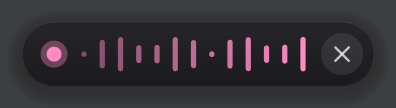
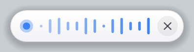

# AudioSpeech

Speech-to-text, using Gemini. A small Windows tray app: press or hold a hotkey, speak, and the text appears in whatever window you are typing in.

 

[Русская версия ниже](#audiospeech-по-русски)

## Features

- Global hotkey (default `Ctrl+Alt+Space`), you can set any combination.
- Three modes: hold or toggle (a short tap toggles, holding is push-to-talk), toggle only, hold only.
- A floating panel shows the microphone level. `Esc` or the cross cancels a recording.
- Transcribes with the Gemini API. If a model is down or overloaded, the next one is tried.
- Pastes the text with `Ctrl+V` and then puts your clipboard back (text or image).
- Keeps the last N recordings (default 10) with their transcripts. Older ones are deleted automatically. If Gemini fails, retry the last recording from the tray menu.
- Dark or light panel, any accent colour, Russian or English interface.
- Crisp on high-DPI screens. One `.exe`, no installer, no dependencies.

## Getting started

1. Get a Gemini API key at [Google AI Studio](https://aistudio.google.com/apikey).
2. Download `AudioSpeech.exe` from [Releases](../../releases), or build it yourself (see below).
3. Run it, double-click the tray icon, paste the key into **Gemini API key** and click **Save**. Instead of entering the key, you can set the `GEMINI_API_KEY` environment variable.
4. Put the cursor in any text field, press the hotkey and speak.

To start AudioSpeech with Windows, put a shortcut to it in the startup folder (`Win+R`, then `shell:startup`).

## Settings

| Setting | Meaning |
| --- | --- |
| Hotkey | Click the button and press the combination. `Esc` cancels. |
| Mode | Hold or toggle, toggle only, hold only. |
| Gemini model | Tried first. Fallbacks: `gemini-3.5-flash`, `gemini-flash-lite-latest`, `gemini-flash-latest`. |
| Gemini API key | Stored in `%APPDATA%\AudioSpeech\settings.json`, on your computer only. |
| Gemini hint | Added to the transcription request. Name your languages, names or terms, for example: *"The speaker usually speaks Russian and may switch to German. Music-theory terms are common."* |
| Language | Russian or English interface. |
| Keep recordings | How many recordings to keep in `%APPDATA%\AudioSpeech\recordings`. |
| Panel theme, Colour | Look of the floating panel. |

Audio goes only to the Gemini API (`generativelanguage.googleapis.com`). There is no other network traffic and no telemetry.

## Build

You need Windows with .NET Framework 4.x, which every Windows 10 and 11 has. No Visual Studio or SDK is needed:

```
build.cmd
```

This runs the built-in `csc.exe` and a self-test. Test flags: `--selftest`, `--rectest` (records 3 s from the microphone), `--looktest` (renders the panel), `--test file.wav` (transcribes a 16 kHz mono WAV into the log).

## Limitations

- Windows only.
- Uses the default Windows microphone (choose it in Windows sound settings).
- The cancel key is always `Esc`.

---

## AudioSpeech по-русски

Распознавание речи через Gemini. Маленькая программа в трее для Windows: нажмите или удерживайте горячую клавишу, скажите что нужно, и текст появится в окне, где стоит курсор.

### Возможности

- Глобальная горячая клавиша (по умолчанию `Ctrl+Alt+Space`), можно задать любое сочетание.
- Три режима: удержание или переключение (короткое нажатие включает и выключает, удержание пишет, пока держите), только переключение, только удержание.
- Плавающая панелька показывает уровень звука. `Esc` или крестик отменяют запись.
- Расшифровка через Gemini API. Если модель недоступна или перегружена, программа пробует следующую.
- Текст вставляется через `Ctrl+V`, потом ваш буфер обмена восстанавливается (текст или картинка).
- Хранятся последние N записей (по умолчанию 10) вместе с текстом, старые удаляются сами. Если Gemini не ответил, последнюю запись можно расшифровать заново из меню в трее.
- Тёмная или светлая панель, любой цвет, русский или английский интерфейс.
- Чёткая картинка при любом масштабе экрана. Один `.exe`, без установки и зависимостей.

### Как начать

1. Получите ключ Gemini API в [Google AI Studio](https://aistudio.google.com/apikey).
2. Скачайте `AudioSpeech.exe` из [Releases](../../releases) или соберите сами (`build.cmd`).
3. Запустите, дважды щёлкните по значку в трее, вставьте ключ в поле **Ключ Gemini API** и нажмите **Сохранить**. Вместо этого можно задать переменную окружения `GEMINI_API_KEY`.
4. Поставьте курсор в любое поле ввода, нажмите горячую клавишу и говорите.

Чтобы программа запускалась вместе с Windows, положите ярлык на неё в папку автозагрузки (`Win+R`, потом `shell:startup`).

В поле **Подсказка Gemini** можно написать, на каких языках вы говорите и какие слова часто встречаются. Это заметно улучшает распознавание терминов.

Звук отправляется только в Gemini API. Других сетевых запросов и телеметрии нет. Ключ хранится только у вас, в `%APPDATA%\AudioSpeech\settings.json`.

## License

[MIT](LICENSE)
